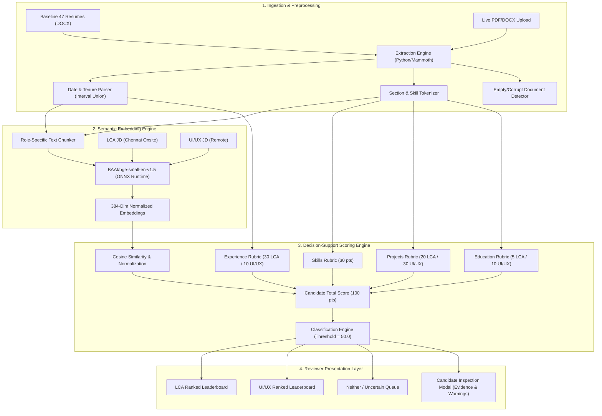

# Growth For Impact (GFI) — Candidate Screening & Resume Ranking System

[](https://nextjs.org/)
[](https://www.typescriptlang.org/)
[](https://tailwindcss.com/)
[](https://huggingface.co/BAAI/bge-small-en-v1.5)
[](#evaluation--testing)
[](tests/e2e/dashboard.spec.ts)
[](scripts/verify_sprint2_http.py)
[-yellow)](reports/pre_deployment_independent_audit.md)

A decision-support web application designed for non-technical hiring teams at **Growth For Impact** to ingest, extract, semantically compare, rank, and classify candidate resumes against two specialized job profiles:
1. **LifeCycle Assessment (LCA) Consultant** (Onsite, Chennai)
2. **UI/UX Designer Intern** (Remote)

---

## 1. Project Overview

Hiring teams frequently receive heterogeneous applicant pools containing candidates for completely different roles. In this challenge, **47 anonymized candidate resumes** were submitted across two distinct functional areas. 

Evaluating these resumes manually creates delays and subjective variance, while naive keyword-search or unverified AI agent summaries risk hallucinations, missing qualifications, and arbitrary scoring. 

### Objectives
- **Ingest & Extract:** Automatically parse unstructured resumes into verified, typed schemas (Work Experience, Project Deliverables, Education, Certifications, and Categorized Skills).
- **Dual-Role Scoring:** Score candidates independently against transparent 100-point rubrics derived from detailed job specifications.
- **Explainable Ranking:** Provide granular requirement-by-requirement evidence, raw cosine metrics, normalized scores, and recruiter eligibility warnings.
- **Independent Classification:** Classify each candidate into **LCA**, **UI/UX**, **Both**, or **Neither / Uncertain** without forced mutual exclusion.
- **Dynamic Uploads:** Allow reviewers to test new PDF/DOCX resumes and immediately see them ranked alongside the baseline pool.

---

## 2. Proposed Solution

The prototype implements a **hybrid extraction and deterministic scoring pipeline**:
1. **Deterministic Parsing & Interval Union:** Recovers structural sections, normalizes disparate date formats (handling Unicode em-dashes, en-dashes, MM/YYYY, and relative durations), and calculates non-overlapping tenure to prevent double-counting.
2. **Semantic Embedding via BGE-Small:** Computes 384-dimensional dense vectors using `BAAI/bge-small-en-v1.5` for JD text and candidate role-specific text chunks.
3. **Bounded Hybrid Scoring:** Combines verifiable requirement sub-scores (85 pts LCA / 80 pts UI/UX) with normalized cosine similarity (15 pts LCA / 20 pts UI/UX), preventing keyword repetition or generic prose from gaming rank position.
4. **Audit Trail & Integrity:** Documents every parser transformation, flags empty or corrupted files, and surfaces source text locators.

---

## 3. System Architecture



### Technology Stack
- **Framework:** Next.js 14.2 (App Router, Server Actions)
- **Language:** TypeScript 5.6 (Strict Mode)
- **Styling:** Tailwind CSS 3.4
- **Vector Embeddings (Dual-Tier):** Optional hosted Hugging Face Router Inference (`router.huggingface.co/hf-inference/models/BAAI/bge-small-en-v1.5`, 384 dimensions; requires `HUGGINGFACE_API_KEY`, live hosted pooling parity pending deployment check) and local ONNX Runtime (`@xenova/transformers`) using mean-pooling and unit L2 normalization
- **Document Parsers:** `mammoth` (DOCX OpenXML AST) and `pdf-parse` (PDF binary extraction) with Central-Directory ZIP safety and sliding-window rate limiting
- **Client Persistence:** Browser IndexedDB via `idb` (`gfi_resume_ranking_db`) with version migration & graceful quota degradation
- **Testing:** Node.js native test runner (`node:test`, 36 tests), Python HTTP verification (11 tests), Playwright E2E browser automation (14 test scenarios)

---

## 4. Scoring Methodology & Rubrics

Each candidate is evaluated against two independent 100-point rubrics:

| Component | LCA Weight | UI/UX Weight | Key Evidence Evaluated |
| :--- | :---: | :---: | :--- |
| **Skills** | **30 pts** | **30 pts** | **LCA:** GaBi or SimaPro hands-on (15 pts), ISO 14040/14044 compliance (8 pts), LCI modeling (7 pts)<br>**UI/UX:** Figma & prototyping (15 pts), human-centered design & design systems (10 pts), user research (5 pts) |
| **Relevant Experience** | **30 pts** | **10 pts** | **LCA:** 2–3+ yrs independent LCA project delivery (ADR-S01 operational rule)<br>**UI/UX:** 0–1 yr welcome (recent grads / career switchers not penalized) |
| **Projects / Portfolio** | **20 pts** | **30 pts** | **LCA:** $\ge 3$ distinct completed LCA studies (mandatory per JD)<br>**UI/UX:** High-fidelity Figma case studies, responsive interfaces, user interviews |
| **Semantic Relevance** | **15 pts** | **20 pts** | BGE-small cosine similarity mapped to reference range $[0.50, 0.85]$ and scaled |
| **Education** | **5 pts** | **10 pts** | **LCA:** Environmental Science / Engineering degree<br>**UI/UX:** Design, HCI, Computer Science, or Media degree |
| **Total** | **100 pts** | **100 pts** | |

### Experience Conflict Handling (ADR-S01)
The assignment overview mentions **4–6 years** for LCA, whereas the detailed JD specifically requires **2–3 years of running LCA projects independently**. The system scores candidates against the 2–3 year requirement provisionally so qualified candidates are not disqualified, while attaching an explicit `experienceConflictNotice` to the candidate's inspection card for recruiter review.

### Subjective Traits Policy
Mandatory traits such as "great aesthetic sense", "creativity without fear of experimentation", and "understanding user psychology" cannot be certified solely by keyword presence. The engine flags these as `requires_human_review` alongside portfolio links.

---

## 5. Dataset Summary

The initial dataset consists of **47 anonymized DOCX resumes**:
- **46 Valid Resumes:** Contain extractable paragraphs, tables, work histories, and deliverables.
- **1 Empty Document (`anonymized_resume_1793685080327.docx`):** Audited down to the raw OOXML XML tree. Contains an empty paragraph container (`<w:t xml:space="preserve"></w:t>`), 0 text nodes, and 0 drawings. Formally logged as `empty_document`, assigned 0.0 scores, and classified as `neither_or_uncertain` (no silent dropping or synthetic hallucination).

---

## 6. Implementation Progress

| Milestone | Status | Description |
| :--- | :---: | :--- |
| **Sprint 0** | **Completed** | Full-text JD extraction, 47-resume input audit (`input_manifest.json`), Next.js skeleton, 100-pt rubrics, ADR-S01. |
| **Sprint 1** | **Completed** | Structured extraction, BGE-small embeddings, deterministic scoring engine, baseline dataset precomputation (`baseline.json`). |
| **Sprint 1.5** | **Completed** | Independent validation audit: fixed Unicode em-dash date bug, scrubbed ISO standard tokens, interval merging, and oracle reconciliation. |
| **Sprint 2** | **Completed** | Interactive multi-tab dashboard, candidate inspection modal, live PDF/DOCX runtime upload API (`/api/upload`). |
| **Sprint 3** | **Completed** | IndexedDB client persistence (`idb`), SHA-256 deduplication, delete/reset controls, privacy notices. |
| **Sprint 3.5** | **Completed** | Persistence mutation serialization, rubric/embedding version migration, Playwright E2E browser regression suite. |
| **Sprint 4 (Pre-Deploy)** | **Pre-Deploy Audit Complete** | Runtime/baseline 47-resume parser parity (`8 LCA / 22 UI/UX / 17 Neither`), Central-Directory ZIP & rate-limit hardening, HF Router client + audit report (Vercel deployment pending). |

---

## 7. Evaluation & Testing

### Automated Verification Suites
- **Unit & Integration Tests (`npm test`):** **36 of 36 passing** across extraction parity (all 47 source DOCX resumes when archive is present), scoring bounds, IndexedDB migration guards, Central-Directory ZIP bomb defense, sliding-window rate limiting, and HF retry/error handling.
- **HTTP Upload Verification (`scripts/verify_sprint2_http.py`):** **11 of 11 passing** against the production server (`DOCX` & `PDF` parity, corrupt binaries -> `400`, scanned 0-text PDF -> `422`, empty DOCX -> `200`, `>5MB` -> `413`, invalid MIME -> `415`, Zip bomb & corrupt internal DOCX -> `400`).
- **Playwright E2E Browser Suite (`npx playwright test`):** **14 of 14 scenarios passing** (navigation tabs, search, scope switcher, modal inspection, DOCX/PDF upload, SHA-256 duplicate dialog, IndexedDB persistence & failure recovery, migration reprocessing).

### Baseline Distribution & Separation (Remediated Baseline)
- **Classification Counts (47 Total Documents):** **8 LCA**, **22 UI/UX**, **0 Both**, **17 Neither / Uncertain** (including 1 empty document at `0.0`).
- **LCA Score Separation:** Qualifying candidates score **51.1**–**84.0**; immediately below the `50.0` cutoff sits borderline `anonymized_VM_1793682784520` (**48.9**), followed by **33.5** (`anonymized_UI_1793682784506`).
- **UI/UX Score Separation:** Qualifying candidates score **57.3**–**96.3**; highest non-qualifying profiles sit at **48.5** and **46.2**, followed by **34.5**.

---

## 8. Repository Structure

```text
├── app/
│   ├── api/upload/route.ts        # Hardened PDF/DOCX ingestion, scoring & upload endpoint
│   ├── globals.css                # Global styles and Tailwind directives
│   ├── layout.tsx                 # Root layout with metadata
│   └── page.tsx                   # Candidate screening overview page
├── components/
│   ├── DashboardClient.tsx        # Tabbed rankings, IndexedDB hydration, delete/reset controls
│   ├── CandidateDetailModal.tsx   # Evidence drawer, rubric breakdowns, warning badges
│   └── ResumeUploadModal.tsx      # SHA-256 pre-flight dedup & live upload modal
├── data/
│   ├── baseline.json              # 47 precomputed candidate records with embeddings & scores
│   ├── calibration_report.json    # Threshold calibration and review sample data
│   ├── cleaning_audit.json        # Extraction transformations and audit log
│   ├── input_manifest.json        # SHA-256 hash inventory of all 47 resumes
│   ├── jds/
│   │   ├── lca.md                 # Verbatim LCA Consultant JD from Tally source
│   │   └── uiux.md                # Verbatim UI/UX Internship JD from Tally source
│   └── rubrics/
│       ├── lca_rubric.json        # 100-pt LCA scoring configuration
│       ├── uiux_rubric.json       # 100-pt UI/UX scoring configuration
│       └── scoring_rubric.md      # Detailed human-readable rubric documentation
├── lib/
│   ├── types.ts                   # Core TypeScript domain models
│   ├── scoring.ts                 # Deterministic scoring and classification logic
│   ├── embeddings.ts              # BGE-small ONNX runtime & HF Router embedding client
│   ├── runtime_extractor.ts       # Runtime PDF/DOCX structural parser (baseline parity)
│   ├── upload_validation.ts       # Central-Directory ZIP safety, magic-byte & rate limiting
│   └── db.ts                      # IndexedDB store, version migration & safe fallback record
├── reports/
│   ├── sprint1_validation.md      # Sprint 1.5 independent validation report
│   ├── extraction_discrepancies.csv # Audited parser discrepancies and resolutions
│   ├── scoring_reconciliation.csv # Baseline vs oracle score comparisons
│   ├── embedding_validation.md    # Model architecture, parity, and pooling checks
│   ├── ranking_evaluation.md      # Classification breakdown, rankings, and threshold analysis
│   ├── manual_review_queue.csv    # Borderline candidates flagged for recruiter review
│   ├── final_submission_audit.md  # Sprint 4 pre-deploy draft readiness audit
│   └── pre_deployment_independent_audit.md # Comprehensive pre-deployment audit & verdict
├── scripts/
│   ├── audit_resumes.py           # Ingestion and XML integrity auditor
│   ├── extract_resumes.py         # Structural section and interval parser
│   ├── process_baseline.mjs       # Embedding generation and scoring pipeline
│   ├── audit_and_validate_sprint1.py # Independent test oracle and reconciliation engine
│   └── verify_sprint2_http.py     # Live HTTP /api/upload contract & security suite (11 tests)
├── tests/
│   ├── sprint0.test.js            # Sprint 0 manifest and rubric tests
│   ├── sprint1.test.js            # Sprint 1 & 1.5 scoring, bounds, and regression tests
│   ├── upload_parity.test.js      # Runtime vs baseline 47-resume & edge-case parity tests
│   ├── sprint3_persistence.test.js # Persistence, migration, ZIP bomb, rate-limit, HF tests
│   └── e2e/dashboard.spec.ts      # Playwright end-to-end browser verification (14 scenarios)
├── .env.example                   # Environment variable template (no real secrets)
├── .eslintrc.json                 # ESLint Next.js core-web-vitals configuration
├── package.json                   # Project dependencies and npm scripts
└── tsconfig.json                  # TypeScript compiler settings
```

---

## 9. Local Setup

### Prerequisites
- **Node.js:** v18.18+ or v20.x (Recommended: v20.20+)
- **Python:** 3.10+ (for preprocessing utilities)

### Installation
```bash
# Clone the repository
git clone https://github.com/kanchanpotdar/GFI-Resume-Ranking.git
cd GFI-Resume-Ranking

# Install dependencies
npm install

# Copy environment template
cp .env.example .env.local
```

### Running Tests & Verification
```bash
# Run full automated unit and integration test suite (36 tests)
npm test

# Run ESLint & TypeScript static verification
npm run lint
npx tsc --noEmit

# Run Next.js production build check
npm run build

# Start production server (in separate terminal) and run HTTP + E2E suites
npx next start -p 3000
python3 scripts/verify_sprint2_http.py   # 11 HTTP upload/security tests
npx playwright test                      # 14 Playwright E2E scenarios
```

### Running the Application
```bash
# Start development server
npm run dev
# Open http://localhost:3000
```

---

## 10. Roadmap

- [x] **Sprint 0:** Repository skeleton, input audit, verbatim JDs, rubric definitions.
- [x] **Sprint 1:** Baseline structured extraction, BGE-small embeddings, scoring engine.
- [x] **Sprint 1.5:** Independent quality validation, date/ISO parser corrections, evaluation metrics.
- [x] **Sprint 2:** Interactive tabbed dashboard, evidence inspection drawer, dynamic PDF/DOCX live upload with content magic-byte verification.
- [x] **Sprint 3:** Browser IndexedDB persistence (`idb`), candidate deletion, clear-all reset controls, dual-role scope ranking, privacy audit (26 passing tests).
- [x] **Sprint 3.5:** Final Quality Remediation & Mandatory Verification Gate: multi-surface SHA-256 deduplication, zip bomb defense, race-condition elimination, version migration, and 14-scenario Playwright E2E browser test suite (30 unit tests + 14 E2E tests passing).
- [x] **Pre-Deployment Independent Audit:** 47-resume runtime/baseline extractor parity (`8 LCA / 22 UI/UX / 17 Neither`), Central-Directory ZIP safety, IP rate limiting, HF Router endpoint update (live token check pending), and ESLint/clean-room gate (**36 unit + 11 HTTP + 14 Playwright E2E passing**).
- [ ] **Sprint 4 (Final Deployment):** Public Vercel deployment, live hosted HF inference verification with `HUGGINGFACE_API_KEY`, public URL smoke test, and final submission.
